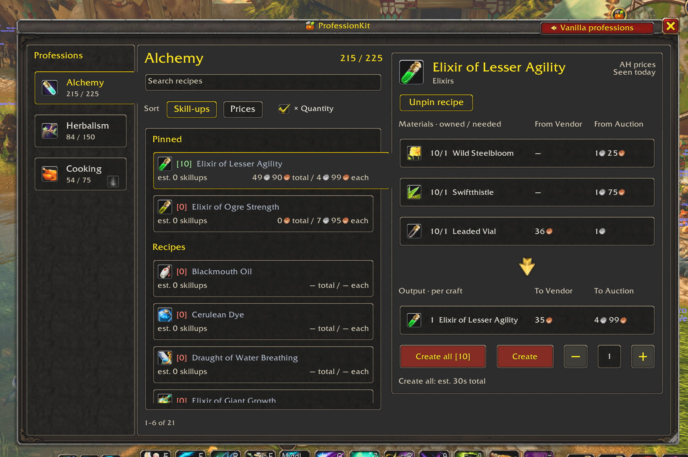

**Whether you're crafting for skill-ups or profits, ProfessionKit can tell you your best options!** ProfessionKit replaces the default professions window for **WoW Forever** and makes the process easy.

Sort your learned recipes by estimated **Skill-ups** when you’re leveling, or by **Prices** when you’re deciding what to sell. Leave **× Quantity** checked to compare crafting everything, or uncheck it to compare single crafts.

## At the crafting bench

- **Keep favorites handy.** Select **Pin recipe** to keep a recipe at the top of its profession. Your pins stay there across reloads.
- **Make your materials count.** With **× Quantity** on, a yellow recipe you can craft a dozen times can outrank an orange recipe you can craft once. Switch to **Prices** to see which batch has the highest auction value.
- **Price both sides of a recipe.** See the auction price of each reagent alongside its vendor price, then check what the finished item sells for. The recipe list shows auction value per item and for the whole batch.

## Getting started

Open a profession as usual, press **K**, click the Field Kit on your minimap, or type `/professionkit`. **Vanilla professions** takes you back to Blizzard’s window for the current session.

**Auctionator is optional.** ProfessionKit uses prices from your local Auctionator scans and shows how recently the output price was seen. Auction values are for the finished items before material costs and auction fees.
